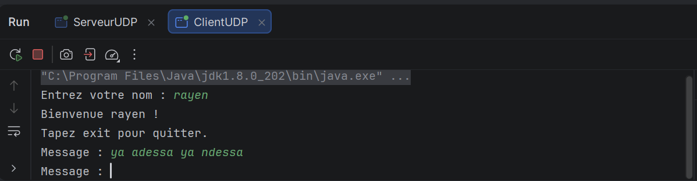
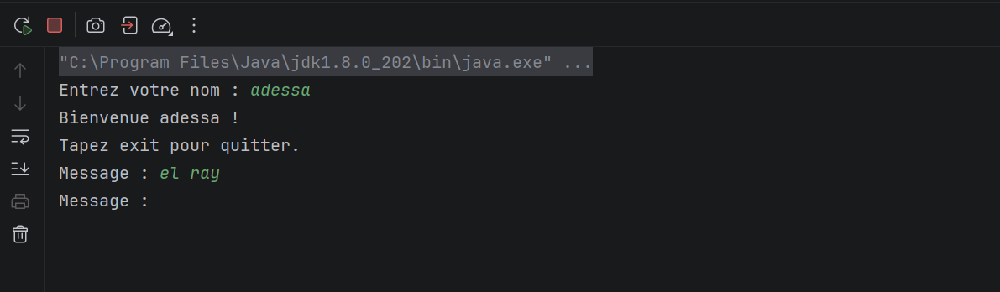
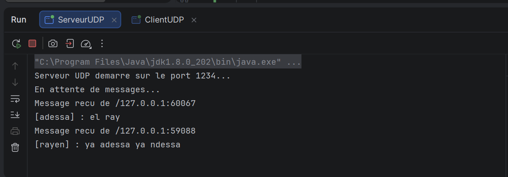

# TP4 – Sockets UDP
## Développement d'applications réparties

**Étudiant :** Rayen Adsi  
**Niveau :** LSI3  
**Année universitaire :** 2026–2027

## 1. Objectif du TP

L'objectif de ce TP est de développer une application de chat client-serveur en utilisant le protocole UDP en Java.

## 2. Technologies utilisées

- Java (JDK 8 ou supérieur)
- IntelliJ IDEA
- UDP (DatagramSocket et DatagramPacket)
- Threads
- Git et GitHub

## 3. Structure du projet

- `ServeurUDP.java` : réception et diffusion des messages.
- `ClientUDP.java` : envoi et réception des messages.

## 4. Fonctionnement

### Étape 1 : Préparation
Création du projet Java dans IntelliJ IDEA.

### Étape 2 : Chat unidirectionnel
Un client envoie des messages au serveur sur le port 1234. Le serveur affiche le message ainsi que l'adresse IP et le port de l'expéditeur.

### Étape 3 : Chat bidirectionnel
Le serveur conserve les adresses des clients dans une collection HashSet et diffuse les messages à tous les autres clients.

Des Threads permettent au client d'envoyer et de recevoir des messages simultanément.

## 5. Captures d'écran

### Client Rayen

### Client Adessa

### Communication entre les clients

## 6. Conclusion

Ce TP m'a permis de comprendre la communication UDP en Java, la manipulation des DatagramSockets et DatagramPackets, ainsi que l'utilisation des Threads pour gérer simultanément l'envoi et la réception des messages.

J'ai également appris à gérer plusieurs clients et à réaliser une diffusion des messages via un serveur UDP.